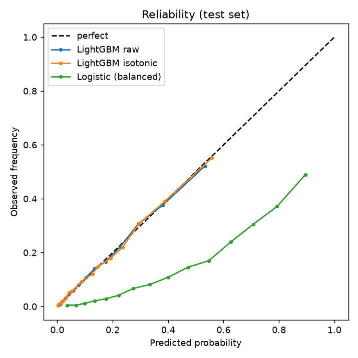

# RiskScope

A calibrated, explainable diabetes-risk model served as a small API, built on the CDC's Behavioral Risk Factor Surveillance System (BRFSS) 2015 survey.

## Why calibration matters

A screening tool is used to decide who gets a follow-up test, so the *number* matters and not only the ranking. If a model says "20%", about one in five such people should have the condition; otherwise thresholds, capacity planning and conversations with patients are built on sand. Diabetes is only 13.9% of this data, which makes raw scores easy to distort (for example by class re-weighting). RiskScope checks calibration with a reliability plot and Brier score, and serves isotonic-calibrated probabilities.

## Data

`data/diabetes_binary_health_indicators_BRFSS2015.parquet`: 253,680 rows, 35,346 positive (diabetes or prediabetes) (13.9%); ratio about 1:6.2, 21 survey features. The target is diabetes or prediabetes. Sources: CDC BRFSS 2015; Kaggle dataset alexteboul/diabetes-health-indicators-dataset (CC0). The file has no respondent id, so the row number is used as `id`. Stratified 60/20/20 train/validation/test split, seed 42.

## Run it

```bash
pip install -r requirements.txt
python -m riskscope.train        # trains, calibrates, writes models/ and reports/
python -m pytest -q              # tests
uvicorn app.main:app             # serves /predict and /health
```

```bash
curl -s localhost:8000/predict -H 'content-type: application/json' -d '{"HighBP":1,"HighChol":1,"CholCheck":1,"BMI":34,"Smoker":0,"Stroke":0,"HeartDiseaseorAttack":0,"PhysActivity":0,"Fruits":1,"Veggies":1,"HvyAlcoholConsump":0,"AnyHealthcare":1,"NoDocbcCost":0,"GenHlth":4,"MentHlth":5,"PhysHlth":10,"DiffWalk":1,"Sex":0,"Age":10,"Education":4,"Income":3}'
```

The response holds `probability`, `risk_band` (low / moderate / high), `flagged_for_screening` and the top 3 contributing features (SHAP values in log-odds, from LightGBM's native tree SHAP).

## Results (test set, 50,736 rows)

| Model | ROC-AUC | PR-AUC | Brier | Recall | Precision |
|---|---|---|---|---|---|
| Logistic regression (balanced weights) | 0.8206 | 0.3997 | 0.1773 | 0.797 | 0.297 |
| LightGBM, raw | 0.8274 | 0.4277 | 0.0970 | 0.794 | 0.303 |
| LightGBM + isotonic (served) | 0.8272 | 0.4191 | 0.0971 | 0.795 | 0.302 |

Recall and precision use a screening threshold chosen on the validation set for 80% recall (each model has its own threshold; the served one is 0.1304 on the calibrated probability). Full detail, SHAP importance and a local explanation are in [`reports/metrics.md`](reports/metrics.md); the reliability plot is `reports/reliability.png` and the SHAP summary `reports/shap_summary.png`.



**Calibration.** The unweighted LightGBM was already close to calibrated, so isotonic regression changes little: Brier on validation goes 0.0966 to 0.0964 (fit on that same set, so a slightly optimistic figure), and on test 0.0970 to 0.0971, with PR-AUC slightly lower because isotonic creates ties. The logistic baseline uses balanced class weights, which is why its Brier is much worse; its probabilities are not calibrated.

## Fairness slice

Calibrated LightGBM at the screening threshold, test set.

| Slice | Group | n | Prevalence | ROC-AUC | Recall | Precision | FPR |
|---|---|---|---|---|---|---|---|
| sex | female | 28430 | 0.129 | 0.837 | 0.789 | 0.301 | 0.272 |
| sex | male | 22306 | 0.152 | 0.814 | 0.802 | 0.304 | 0.330 |
| age_group | 18-34 | 4944 | 0.022 | 0.795 | 0.250 | 0.208 | 0.021 |
| age_group | 35-49 | 9948 | 0.071 | 0.843 | 0.583 | 0.259 | 0.127 |
| age_group | 50-64 | 17940 | 0.144 | 0.826 | 0.794 | 0.309 | 0.299 |
| age_group | 65+ | 17904 | 0.205 | 0.762 | 0.853 | 0.306 | 0.499 |

Plainly: the model is not equally good for everyone. Discrimination is lower for people 65+ (and for men than women), and at one shared threshold the young are flagged far less often as a share of true cases (low recall in 18-34, where prevalence is very low) while people 65+ have a false-positive rate near 50%. A single threshold trades these off unevenly; group-specific thresholds or bands would be a decision for the people running a real screen. Sex is a binary survey field here.

## Choices

- LightGBM (CPU) vs a logistic-regression baseline; light grid over leaves, learning rate and min child samples, picked on validation PR-AUC with early stopping on AUC.
- No class re-weighting for LightGBM; imbalance is handled by the recall-based threshold. (An earlier weighted attempt stopped after a handful of trees and scored worse.)
- SHAP `TreeExplainer` is used for the global and local explanations.
- Risk bands: low is below half the training base rate, high is at or above the screening threshold, moderate in between.

## Not medical advice, and limits

RiskScope is a portfolio project, not a medical device, and gives no diagnosis or medical advice. The data is self-reported 2015 US survey data: it has recall and response bias, no lab values, and the target mixes diabetes with prediabetes. Associations (for example with BMI or income) are not causal. Performance was measured on one random split of the same survey, so it may not carry over to other populations or years. Subgroup gaps are shown above and small subgroups are noisy.
